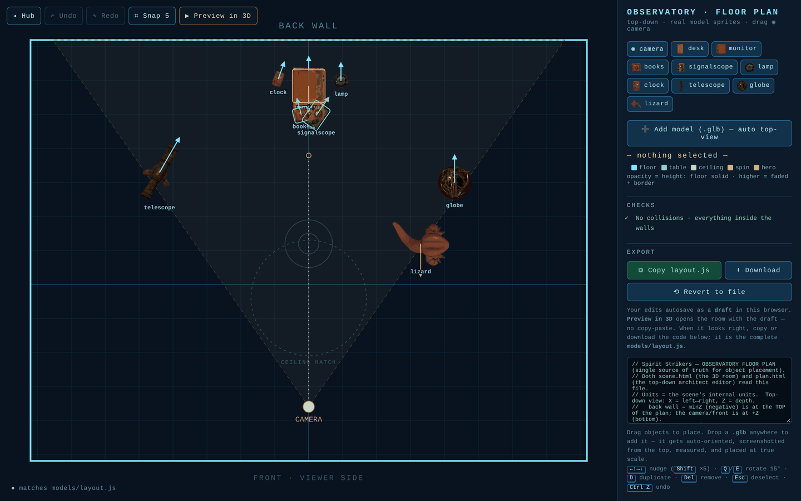
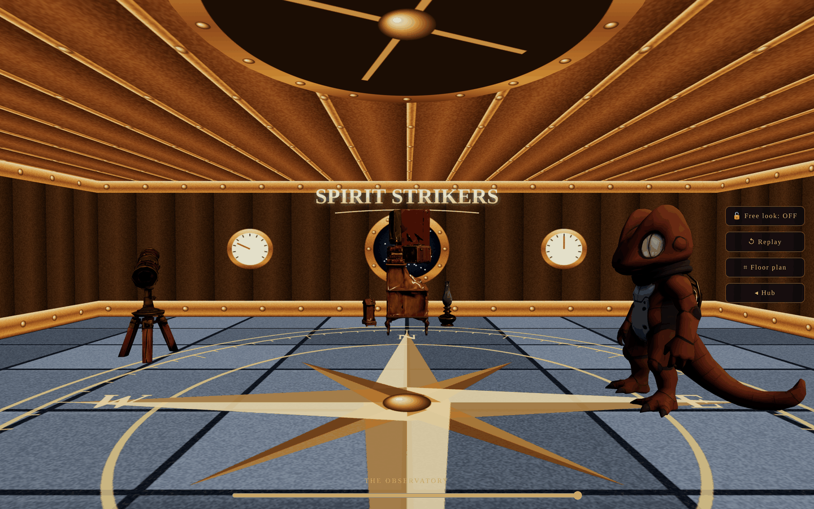
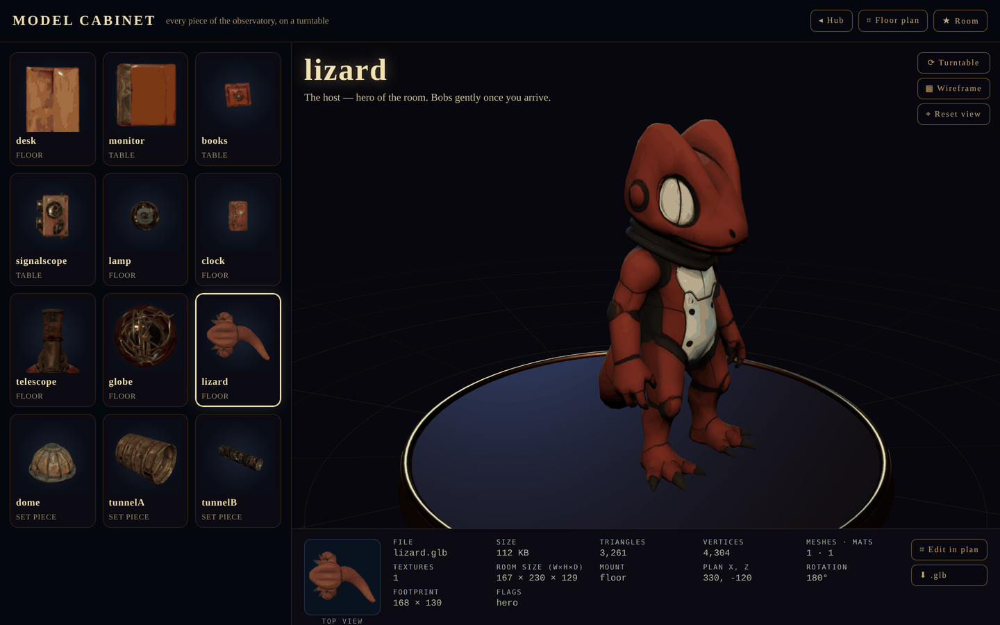
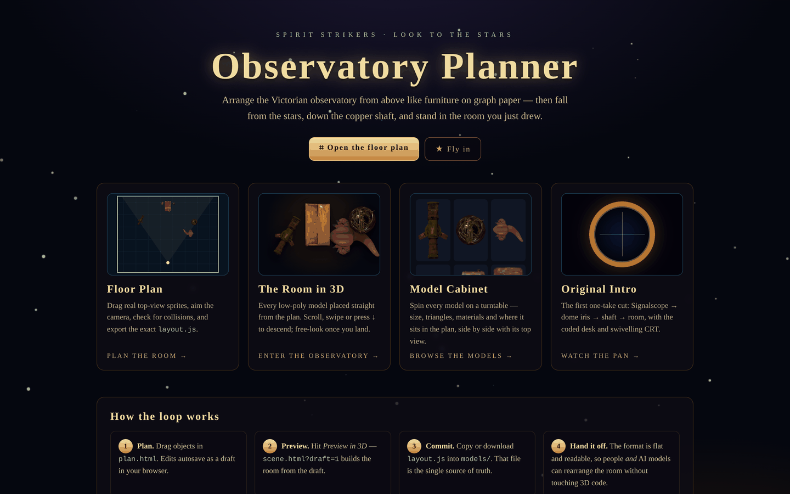
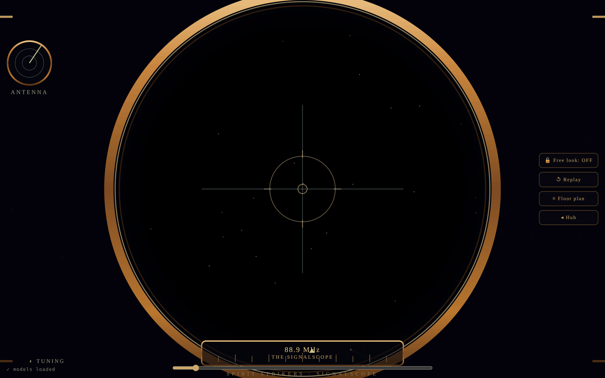
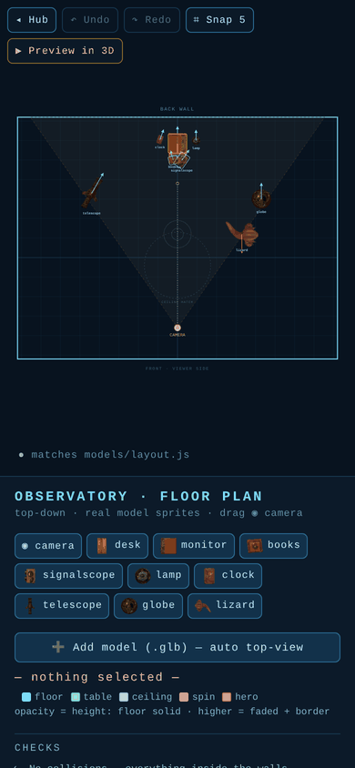

# Observatory Planner — top-down layout editor for a 3D room

Plan a Three.js room **from above**, like furniture on graph paper, then copy the exact `layout.js`
the 3D scene consumes. What you drag on the plan is what the camera flies through in 3D.

Part of the Spirit Strikers world: a Victorian observatory (telescope, terminal, globe, clock, books,
the lizard) that the site's intro sequence flies into.



| The room in 3D | Model Cabinet |
|---|---|
|  |  |

| Hub | Signalscope opening | Planner on a phone |
|---|---|---|
|  |  |  |

## Run it

```bash
npm run serve          # or: python3 -m http.server 8803
# open http://localhost:8803/
```

There's no build step. Three.js is vendored in `lib/` and loaded through an import map, so the pages
work offline from any static file server. (They need a server; opening them from `file://` won't work
because ES modules can't load that way.)

## The pages

| Page | What it does |
|---|---|
| `index.html` | **Hub.** Links to everything, with a live mini floor plan drawn from `layout.js`. |
| `plan.html` | **The planner.** Top-down SVG floor plan built from real top-view sprites. Drag objects. Drag the gold ◉ to move the camera, and set its eye height and gaze. Click an object to set rotation, height, mount plane (floor · table top · ceiling) and spin. Drop a `.glb` to add a model; it's auto-measured and given a top-view sprite. |
| `scene.html` | **The 3D room.** Stars → dome iris → copper shaft → observatory. Every GLB is placed from `models/layout.js`. Scroll, swipe, press ↓/Space, or drag the slider to descend. `?auto=1` plays the flight by itself, `?p=100` jumps to the room, and `?draft=1` previews the planner's draft. |
| `models.html` | **Model Cabinet.** Shows every GLB on a turntable with triangle and vertex counts, materials, file size, size in the room, and plan placement next to its top view. Includes wireframe and download buttons, and **Edit in plan** jumps to that object in the planner. `?m=<id>` deep-links to a model; ←/→ cycles through them. |
| `intro.html` | The original one-take intro, with the coded desk and swivelling CRT. |
| `models/layout.js` | The single source of truth for object placement. `plan.html` writes it; the other pages read it. |

## The workflow

1. **Plan.** Arrange the room in `plan.html`. Every edit **autosaves as a draft** in your browser, and undo/redo works.
2. **Check.** The *Checks* panel flags objects that poke through a wall, floor objects that collide, table props that aren't on the desk, and camera or gaze problems.
3. **Preview.** **▶ Preview in 3D** opens `scene.html?draft=1`, which builds the room from the draft. No copy-paste needed.
4. **Commit.** **Copy layout.js** or **Download**, then replace `models/layout.js`. The export is the complete file: `ROOM` (including the camera) plus `ITEMS`.

Because the layout is a flat data file, **anyone (including AI models)** can rearrange the room without touching 3D code.
`plan.html` also exposes a small automation API in the console: `getLayout()`, `getCam()`, `layoutCode()`, `checks()` and `addModelBuffer(arrayBuffer, name, height)`.

### Planner shortcuts

| Key | Action |
|---|---|
| Drag | move object / camera (5-unit snap; `G` toggles snap) |
| `←↑→↓` | nudge 5 units (`Shift`: 25 units) |
| `Q` / `E` | rotate −15° / +15° |
| `D` | duplicate |
| `Del` / `Backspace` | remove |
| `Esc` | deselect |
| `Ctrl/⌘ Z`, `Ctrl/⌘ Shift Z`, `Ctrl Y` | undo / redo |

## Art and textures

The room's painted art (`images/obs-stone.png`, `obs-wall*.png`, `obs-dome.png`, `obs-doors.png`,
`obs-hatch.png`, `compass.png`, `tunnel-copper-sm.jpg`, `striker-swoosh.png`, `lizard.png`) lives in the
**spirit-strikers-site** repo. Copy it into `images/` and the pages use it. Without it, `js/textures.js`
draws procedural stand-ins in the same palette (slate tiles, walnut and brass panels with rivets, a
porthole wall with gauges, copper dome ribs, a brass compass rose, and a gold wordmark), so the room still
looks finished. In `intro.html`, if the lizard cut-out is missing, the real `lizard.glb` stands in for it.

## Project layout

```
index.html  plan.html  scene.html  models.html  intro.html
js/layout-store.js   draft autosave + the exact layout.js code generator (shared)
js/textures.js       image loader with procedural fallbacks (shared)
models/*.glb         low-poly meshopt-compressed models (~3 MB)
models/top/*.png     true top-view renders used as plan sprites (+ meta.json footprints)
models/layout.js     the floor plan
lib/                 vendored Three.js (see lib/VERSION)
scripts/vendor.mjs   copies the needed Three.js files from node_modules into lib/
scripts/check.mjs    headless smoke test + README screenshots
```

## Development

```bash
npm install            # only needed to update Three.js or run the checks
npm run vendor         # refresh lib/ from node_modules/three
npm run check          # open every page at desktop + phone sizes; fail on JS errors, 404s or sideways scroll
npm run screenshots    # same, and also write docs/screenshots/*.png
```

The checks use Playwright with Chromium (`npm i -D playwright` if you don't have it installed globally).

---
Built for [spiritstriker.app](https://spiritstriker.app) (see *spirit-strikers-site*).
Sibling tool: *site-blueprint*, which applies the same plan-and-code approach to 2D web pages.
